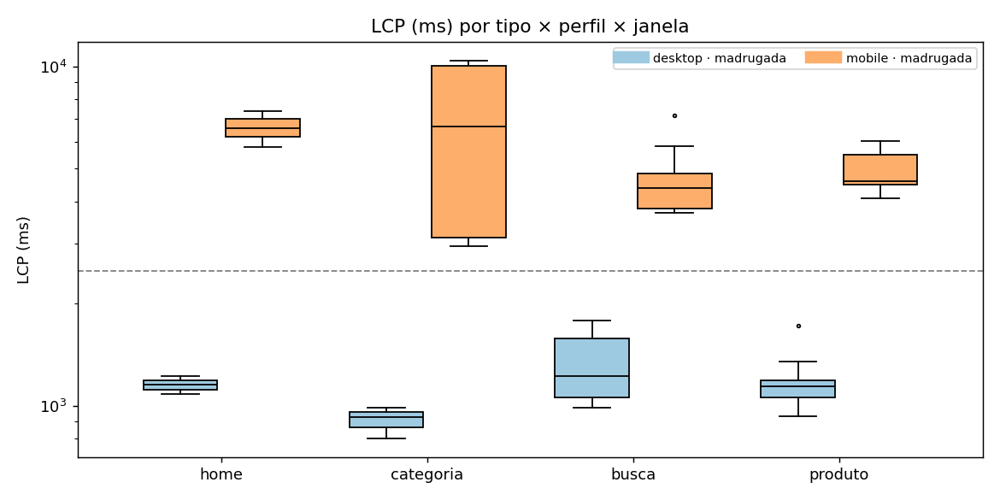
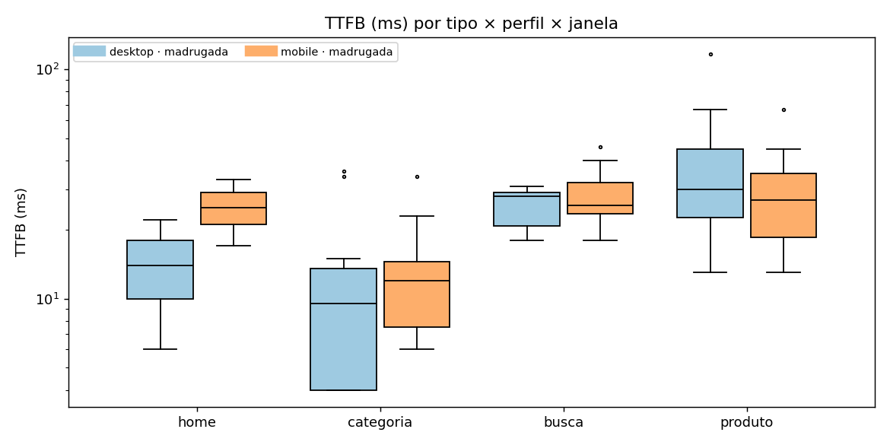
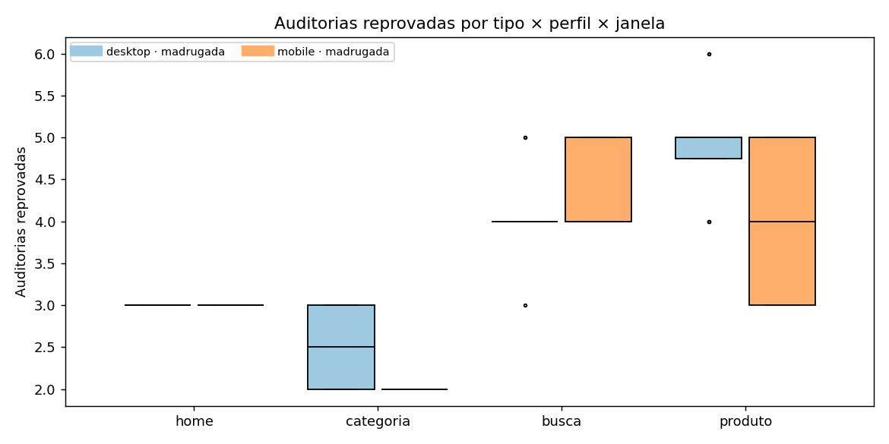
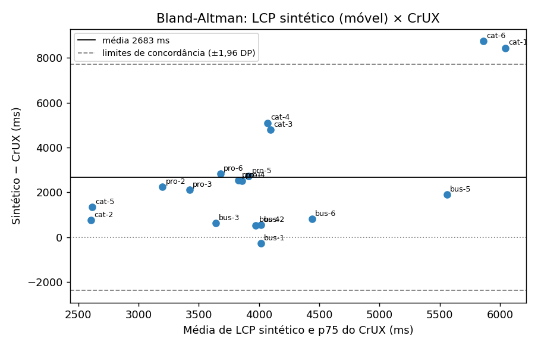
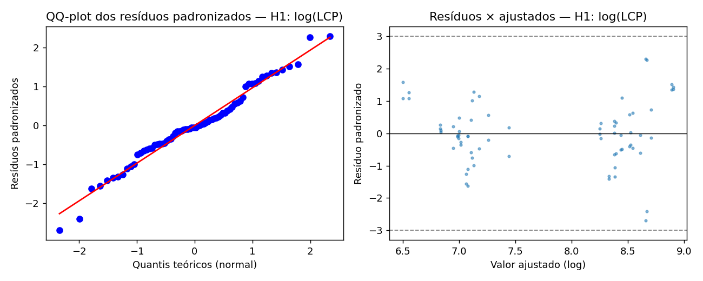
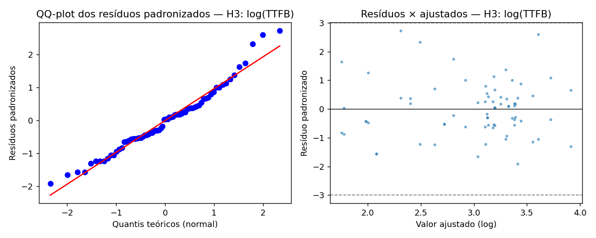

# Análise (#C-4, #C-6)

Gerado por `analysis/analise.py --input data/raw/2026-11-19_BRT.csv`. Datas: 2026-11-19 a 2026-11-19 (1 dia, 2 execuções). Linhas lidas: 76; após o filtro mínimo: 76.

## Avisos

- Sem p-valor (ficaram fora do Holm): H3.
- Só há uma janela nos dados: o efeito de pico (H3) não pode ser estimado.

## Testes de hipótese (primários, bilaterais, Holm sobre os 5)

| hipotese | teste | metodo_p | n | estatistica_nome | estatistica | p | p_holm | efeito_nome | efeito | IC 95% |
|---|---|---|---|---|---|---|---|---|---|---|
| H1 | Modelo misto, log(LCP) | modelo em log | 72 |  | — | < 0,001 | < 0,001 | razão móvel/desktop | 4,516 | 4,044 a 5,043 |
| H2 | Kruskal-Wallis, mediana do LCP por URL (móvel) | Kruskal-Wallis | 18 | H | 2,117 | 0,347 | 0,347 | ε² | 0,125 | 0,008 a 0,813 |
| H3 | Modelo misto, log(TTFB) | modelo em log | 72 |  | — | — | — | razão pico/madrugada | — |  |
| H4 | Kruskal-Wallis, moda das reprovadas por URL (móvel) | Kruskal-Wallis | 18 | H | 12,610 | 0,002 | 0,004 | ε² | 0,742 | 0,726 a 0,887 |
| H5 | Wilcoxon pareado, LCP sintético × p75 CrUX (móvel) | Wilcoxon pareado | 18 |  | — | < 0,001 | < 0,001 | kappa (categoria) | -0,047 |  |

H5: Spearman ρ = -0,368; Bland-Altman: média 2.683 ms, limites -2.356 a 7.723 ms.

As razões de H1 e H3 têm IC de Wald do modelo em log; o ε² de H2 e H4 e o Cliff's delta têm IC percentil por bootstrap (2000 reamostragens, semente 20261126).

### Diagnóstico dos modelos mistos e alternativa robusta

Critério fixado antes de olhar os p (design §5.8): se mais de 5% dos resíduos padronizados passarem de ±3, o p primário vem do modelo misto sobre postos alinhados (ART). H1: 0,0% dos resíduos além de ±3, dentro do limite de 5%, então vale o modelo em log. H3: 0,0% dos resíduos além de ±3, dentro do limite de 5%, então vale o modelo em log.

| hipotese | frac_residuos_3 | limiar | usa_art | p_modelo_log | p_art |
|---|---|---|---|---|---|
| H1 | 0,000 | 0,050 | não | < 0,001 | — |
| H3 | 0,000 | 0,050 | não | — | — |

QQ-plots e resíduos × ajustados em `residuos_H1.png` e `residuos_H3.png`.

### Mudança de versão do Lighthouse

Não houve mudança de versão: todas as linhas usam o Lighthouse 13.6.0. A rodada sem os dias afetados não se aplica.

### Post-hoc de Dunn

**H2** (p de Holm):

| tipo | busca | categoria | produto |
|---|---|---|---|
| busca | 1,000 | 0,479 | 0,609 |
| categoria | 0,479 | 1,000 | 0,705 |
| produto | 0,609 | 0,705 | 1,000 |

**H4** (p de Holm):

| tipo | busca | categoria | produto |
|---|---|---|---|
| busca | 1,000 | 0,003 | 0,651 |
| categoria | 0,003 | 1,000 | 0,009 |
| produto | 0,651 | 0,009 | 1,000 |

### Sensibilidade no desktop (fora do Holm)

| hipotese | perfil | H | p | eps2 |
|---|---|---|---|---|
| H2 | desktop | 12,117 | 0,002 | 0,713 |
| H4 | desktop | 12,694 | 0,002 | 0,747 |

### Cliff's delta sobre as medianas por slot

| efeito | metrica | grupo_a | grupo_b | n_unidades | cliffs_delta | ic_inf | ic_sup |
|---|---|---|---|---|---|---|---|
| perfil | lcp_ms | mobile | desktop | 18 | 1,000 | 1,000 | 1,000 |
| horario | ttfb_ms | pico | madrugada | 0 | — | — | — |

## Descritiva: medianas e SLI por combinação

LCP e TTFB em ms; SLI = fração das medições com LCP ≤ 2,5 s. Os valores completos (IQR, p75, p90) estão em `descritiva_agregado.csv` e, por URL, em `descritiva_slot.csv`.

| tipo | strategy | janela | a11y_reprovadas | lcp_ms | ttfb_ms | sli |
|---|---|---|---|---|---|---|
| busca | desktop | madrugada | 4,00 | 1.220,31 | 28,00 | 1,00 |
| busca | mobile | madrugada | 4,00 | 4.398,53 | 25,50 | 0,00 |
| categoria | desktop | madrugada | 2,50 | 926,26 | 9,50 | 1,00 |
| categoria | mobile | madrugada | 2,00 | 6.678,67 | 12,00 | 0,00 |
| home | desktop | madrugada | 3,00 | 1.152,00 | 14,00 | 1,00 |
| home | mobile | madrugada | 3,00 | 6.604,10 | 25,00 | 0,00 |
| produto | desktop | madrugada | 5,00 | 1.140,00 | 30,00 | 1,00 |
| produto | mobile | madrugada | 4,00 | 4.597,52 | 27,00 | 0,00 |

## Falhas da coleta (disparos agendados, antes do filtro)

| nivel | total | com_falha | taxa |
|---|---|---|---|
| linha | 76 | 0 | 0,000 |
| execucao | 2 | 0 | 0,000 |
| linha_bloqueada | 76 | 0 | 0,000 |
| linha_com_erro | 76 | 0 | 0,000 |

A taxa é calculada sobre a entrada lida. Com o dataset validado (`data/processed/dataset.csv`) como entrada, as linhas com erro já foram excluídas pela validação (`scripts/validate.py`), e a taxa sai zerada; a taxa da coleta bruta está na seção "Validação da coleta principal" de `docs/anomalias.md`.

## Gráficos

