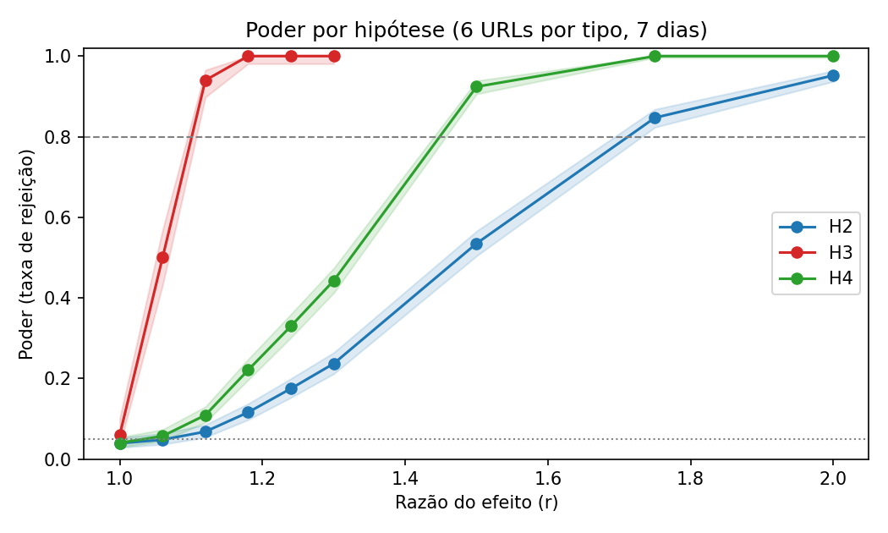

# Efeito mínimo detectável e erro tipo I (#C-3)

Gerado por `analysis/poder.py` (semente 20261123). Desenho simulado: 6 URLs por tipo (categoria, busca e produto; sem a home), 7 dias e 2 execuções por janela. Nível de significância 0,05; poder-alvo 0,8.

O efeito é uma **razão r**. Em H2 e H4, os três tipos ficam em 1, √r e r (o tipo mais alto é r× o mais baixo). Em H3, o TTFB do pico é r× o da madrugada. Com r = 1,00 não há efeito, e a taxa de rejeição é o erro tipo I.

## Efeito mínimo detectável

| Hipótese | Datasets por nível | Menor r com poder ≥ 0,8 (grade 1,00–1,30) | Grade estendida (até 2,00) | Erro tipo I (IC 95%) | Tempo |
|---|---|---|---|---|---|
| H2: LCP difere entre os tipos (móvel) | 1000 | > 1,30 | 1,75 | 0,039 (0,029–0,053) | 4,8 s |
| H3: TTFB maior no pico | 200 | 1,12 | — | 0,060 (0,035–0,102) | 234,0 s |
| H4: nº de reprovadas difere entre os tipos | 1000 | > 1,30 | 1,50 | 0,040 (0,030–0,054) | 4,4 s |

O erro tipo I observado fica entre 0,03 e 0,07 nas três hipóteses. Tempo total: 243,2 s.

## Curvas de poder

| r | H2 | H3 | H4 |
|---|---|---|---|
| 1,00 | 0,039 | 0,060 | 0,040 |
| 1,06 | 0,048 | 0,500 | 0,057 |
| 1,12 | 0,068 | 0,940 | 0,109 |
| 1,18 | 0,116 | 1,000 | 0,221 |
| 1,24 | 0,175 | 1,000 | 0,330 |
| 1,30 | 0,237 | 1,000 | 0,443 |
| 1,50 | 0,535 |  | 0,924 |
| 1,75 | 0,847 |  | 1,000 |
| 2,00 | 0,952 |  | 1,000 |

Os valores com IC de Wilson estão em `poder.csv`.

## Parâmetros usados

Calculados por este script a partir do piloto (#C-1: 72 linhas sem a home, 2 execuções de madrugada de 19/11). DP em escala log.

| Parâmetro | Valor | Origem |
|---|---|---|
| LCP móvel: DP entre URLs | 0,247 | piloto |
| LCP móvel: DP entre execuções | 0,296 | piloto |
| LCP móvel: DP entre dias | 0,049 | dados de 19/11 em diante (5 dias) |
| TTFB: DP entre URLs (média dos perfis) | 0,490 | piloto |
| TTFB: DP entre execuções, desktop / móvel | 0,552 / 0,452 | piloto |
| TTFB: DP entre dias | 0,019 | dados de 19/11 em diante (5 dias) |
| Reprovadas: média do valor modal por URL | 3,44 | piloto |
| Reprovadas: desvios por URL em relação à mediana do tipo | [-1, -1, 0, 0, 0, 0, 0, 0, 0, 0, 0, 0, 0, 0, 1, 1, 1, 1] | piloto |

## Como cada hipótese foi simulada

- **H2:** para cada URL, 28 execuções no perfil móvel: log(LCP) = média + efeito do tipo + efeito da URL + efeito do dia + ruído, todos normais. A URL entra no teste pela mediana, e o teste é o Kruskal-Wallis entre os tipos, o mesmo de `stats.kruskal_por_tipo`.
- **H4:** cada URL entra com um só valor, o modal, porque as reprovadas quase não mudam entre execuções (3 de 38 combinações mudaram no piloto). O valor é a média do tipo arredondada de forma estocástica, mais um desvio inteiro sorteado dos desvios reais do piloto. Não se usou Poisson, porque no piloto a variância dentro de cada tipo (0 a 0,8) é bem menor que a média (2 a 4,3).
- **H3:** um dataset completo de TTFB (18 URLs × 2 perfis × 2 janelas × 7 dias × 2 execuções = 1.008 linhas), ajustado com `stats.modelo_misto`, o mesmo modelo da análise. O teste é o p-valor do efeito de pico. 0 de 1200 ajustes não convergiram.

## Limitações

- **Parâmetros instáveis.** O piloto tem só 2 execuções por URL, então os DPs entre execuções são uma ordem de grandeza, não um valor preciso.
- **Sem variação entre dias no piloto.** O DP entre dias vem dos dias coletados até agora, que ainda são poucos.
- **LCP em dois níveis.** A C-1 mostrou que o LCP das categorias no celular alterna entre ~3 s e ~10 s. A simulação supõe um LCP log-normal, o que não reproduz essa mistura. Como H2 usa a mediana por URL, o efeito mais provável é uma variação entre URLs maior que a simulada, e um poder real menor.
- **H3 com 200 datasets por nível.** A margem de erro do poder e do erro tipo I é de cerca de ±0,03.
- **Efeitos de tipo, perfil e interações** foram fixados em zero em H3, e o pico foi simulado igual em todas as células.
