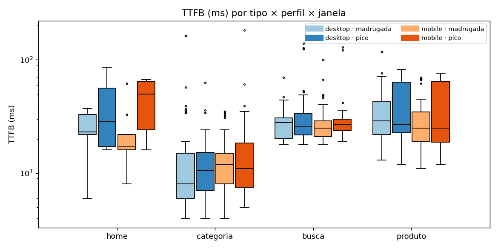

# Análise (#C-4)

Gerado por `analysis/analise.py --input data/raw`. Datas: 2026-11-19 a 2026-11-23 (5 dias, 15 execuções). Linhas lidas: 570; após o filtro mínimo: 569.

## Avisos

- Nenhum.

## Testes de hipótese (primários, bilaterais, Holm sobre os 5)

| hipotese | teste | n | estatistica_nome | estatistica | p | p_holm | efeito_nome | efeito | IC 95% |
|---|---|---|---|---|---|---|---|---|---|
| H1 | Modelo misto, log(LCP) | 539 |  | — | < 0,001 | < 0,001 | razão móvel/desktop | 3,909 | 3,736 a 4,091 |
| H2 | Kruskal-Wallis, mediana do LCP por URL (móvel) | 18 | H | 4,292 | 0,117 | 0,117 | ε² | 0,252 |  |
| H3 | Modelo misto, log(TTFB) | 539 |  | — | 0,056 | 0,111 | razão pico/madrugada | 1,097 | 0,998 a 1,206 |
| H4 | Kruskal-Wallis, moda das reprovadas por URL (móvel) | 18 | H | 12,415 | 0,002 | 0,006 | ε² | 0,730 |  |
| H5 | Wilcoxon pareado, LCP sintético × p75 CrUX (móvel) | 18 |  | — | < 0,001 | < 0,001 | kappa (categoria) | 0,000 |  |

H5: Spearman ρ = 0,077; Bland-Altman: média 1.848 ms, limites -1.855 a 5.550 ms.

### Post-hoc de Dunn

**H2** (p de Holm):

| tipo | busca | categoria | produto |
|---|---|---|---|
| busca | 1,000 | 0,829 | 0,187 |
| categoria | 0,829 | 1,000 | 0,175 |
| produto | 0,187 | 0,175 | 1,000 |

**H4** (p de Holm):

| tipo | busca | categoria | produto |
|---|---|---|---|
| busca | 1,000 | 0,004 | 0,778 |
| categoria | 0,004 | 1,000 | 0,007 |
| produto | 0,778 | 0,007 | 1,000 |

### Sensibilidade no desktop (fora do Holm)

| hipotese | perfil | H | p | eps2 |
|---|---|---|---|---|
| H2 | desktop | 11,556 | 0,003 | 0,680 |
| H4 | desktop | 14,448 | 7,3e-04 | 0,850 |

### Cliff's delta sobre as medianas por slot

| efeito | metrica | grupo_a | grupo_b | n_a | n_b | cliffs_delta |
|---|---|---|---|---|---|---|
| perfil | lcp_ms | mobile | desktop | 18 | 18 | 1,000 |
| horario | ttfb_ms | pico | madrugada | 36 | 36 | 0,083 |

## Descritiva: medianas e SLI por combinação

LCP e TTFB em ms; SLI = fração das medições com LCP ≤ 2,5 s. Os valores completos (IQR, p75, p90) estão em `descritiva_agregado.csv` e, por URL, em `descritiva_slot.csv`.

| tipo | strategy | janela | a11y_reprovadas | lcp_ms | ttfb_ms | sli |
|---|---|---|---|---|---|---|
| busca | desktop | madrugada | 4,00 | 1.339,30 | 28,00 | 1,00 |
| busca | desktop | pico | 4,00 | 1.148,87 | 25,50 | 1,00 |
| busca | mobile | madrugada | 4,00 | 4.055,53 | 25,00 | 0,00 |
| busca | mobile | pico | 4,00 | 4.428,78 | 27,00 | 0,00 |
| categoria | desktop | madrugada | 2,00 | 947,50 | 8,00 | 1,00 |
| categoria | desktop | pico | 2,50 | 973,51 | 10,50 | 1,00 |
| categoria | mobile | madrugada | 2,00 | 3.177,79 | 12,00 | 0,00 |
| categoria | mobile | pico | 2,00 | 3.710,84 | 11,00 | 0,00 |
| home | desktop | madrugada | 4,00 | 1.262,00 | 23,00 | 1,00 |
| home | desktop | pico | 4,00 | 1.162,00 | 28,50 | 1,00 |
| home | mobile | madrugada | 3,00 | 5.885,02 | 17,00 | 0,00 |
| home | mobile | pico | 3,00 | 3.997,76 | 50,00 | 0,00 |
| produto | desktop | madrugada | 5,00 | 1.282,00 | 29,00 | 1,00 |
| produto | desktop | pico | 5,00 | 1.282,00 | 27,00 | 1,00 |
| produto | mobile | madrugada | 4,00 | 4.745,33 | 25,00 | 0,00 |
| produto | mobile | pico | 4,00 | 4.680,01 | 25,00 | 0,00 |

## Falhas da coleta (disparos agendados, antes do filtro)

| nivel | total | com_falha | taxa |
|---|---|---|---|
| linha | 570 | 1 | 0,002 |
| execucao | 15 | 1 | 0,067 |
| linha_bloqueada | 570 | 0 | 0,000 |
| linha_com_erro | 570 | 1 | 0,002 |

## Gráficos

