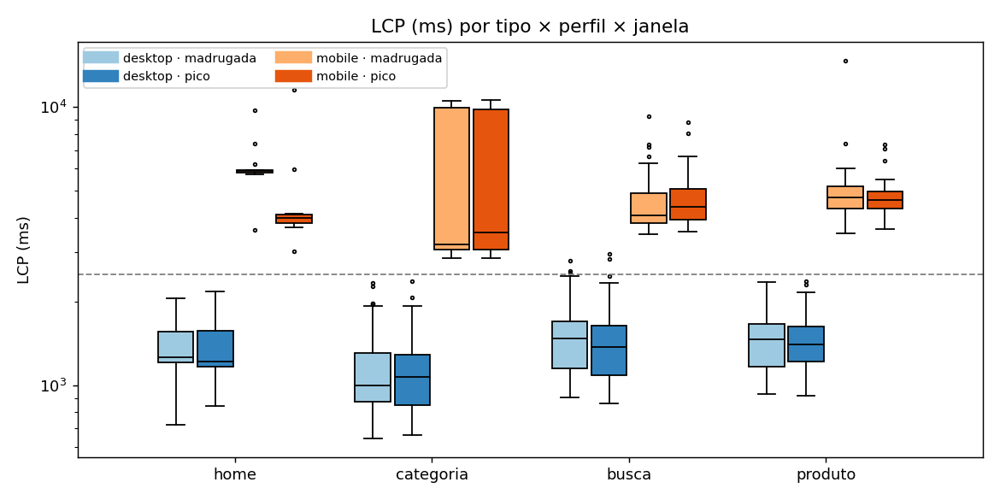
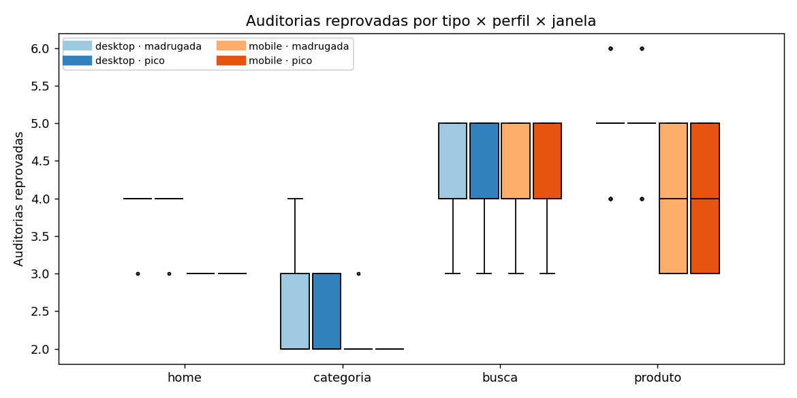
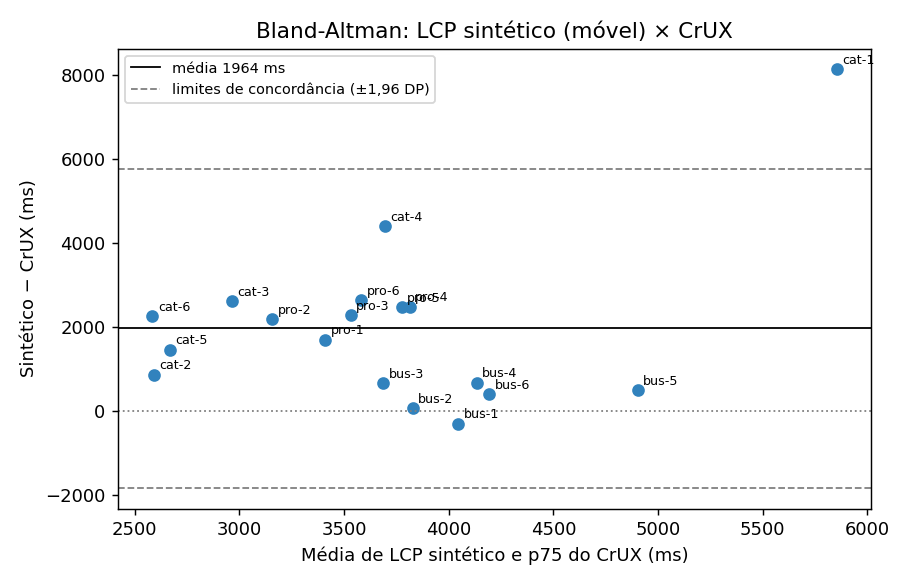
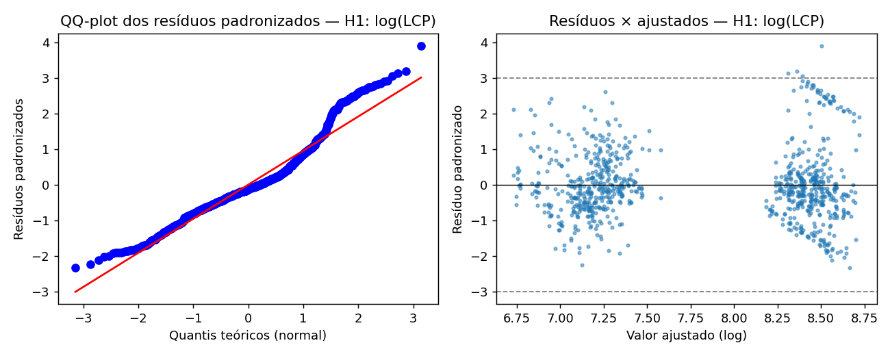
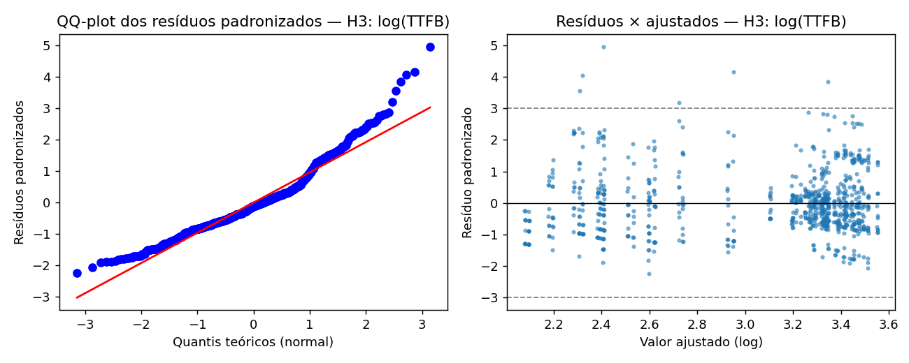

# Análise (#C-4, #C-6)

Gerado por `analysis/analise.py --input data/processed/dataset.csv`. Datas: 2026-11-19 a 2026-11-25 (7 dias, 23 execuções). Linhas lidas: 873; após o filtro mínimo: 873.

## Avisos

- Nenhum.

## Testes de hipótese (primários, bilaterais, Holm sobre os 5)

| hipotese | teste | metodo_p | n | estatistica_nome | estatistica | p | p_holm | efeito_nome | efeito | IC 95% |
|---|---|---|---|---|---|---|---|---|---|---|
| H1 | Modelo misto, log(LCP) | modelo em log | 827 |  | — | < 0,001 | < 0,001 | razão móvel/desktop | 3,576 | 3,440 a 3,717 |
| H2 | Kruskal-Wallis, mediana do LCP por URL (móvel) | Kruskal-Wallis | 18 | H | 1,275 | 0,529 | 0,529 | ε² | 0,075 | 0,006 a 0,651 |
| H3 | Modelo misto, log(TTFB) | modelo em log | 827 |  | — | 0,233 | 0,466 | razão pico/madrugada | 1,047 | 0,971 a 1,128 |
| H4 | Kruskal-Wallis, moda das reprovadas por URL (móvel) | Kruskal-Wallis | 18 | H | 12,793 | 0,002 | 0,005 | ε² | 0,753 | 0,727 a 0,914 |
| H5 | Wilcoxon pareado, LCP sintético × p75 CrUX (móvel) | Wilcoxon pareado | 18 |  | — | < 0,001 | < 0,001 | kappa (categoria) | -0,095 |  |

H5: Spearman ρ = 0,046; Bland-Altman: média 1.964 ms, limites -1.836 a 5.764 ms.

As razões de H1 e H3 têm IC de Wald do modelo em log; o ε² de H2 e H4 e o Cliff's delta têm IC percentil por bootstrap (2000 reamostragens, semente 20261126).

### Diagnóstico dos modelos mistos e alternativa robusta

Critério fixado antes de olhar os p (design §5.8): se mais de 5% dos resíduos padronizados passarem de ±3, o p primário vem do modelo misto sobre postos alinhados (ART). H1: 0,5% dos resíduos além de ±3, dentro do limite de 5%, então vale o modelo em log. H3: 0,7% dos resíduos além de ±3, dentro do limite de 5%, então vale o modelo em log.

| hipotese | frac_residuos_3 | limiar | usa_art | p_modelo_log | p_art |
|---|---|---|---|---|---|
| H1 | 0,005 | 0,050 | não | < 0,001 | — |
| H3 | 0,007 | 0,050 | não | 0,233 | — |

QQ-plots e resíduos × ajustados em `residuos_H1.png` e `residuos_H3.png`.

### Mudança de versão do Lighthouse

Não houve mudança de versão: todas as linhas usam o Lighthouse 13.6.0. A rodada sem os dias afetados não se aplica.

### Post-hoc de Dunn

**H2** (p de Holm):

| tipo | busca | categoria | produto |
|---|---|---|---|
| busca | 1,000 | 0,914 | 0,913 |
| categoria | 0,914 | 1,000 | 0,913 |
| produto | 0,913 | 0,913 | 1,000 |

**H4** (p de Holm):

| tipo | busca | categoria | produto |
|---|---|---|---|
| busca | 1,000 | 0,002 | 0,499 |
| categoria | 0,002 | 1,000 | 0,014 |
| produto | 0,499 | 0,014 | 1,000 |

### Sensibilidade no desktop (fora do Holm)

| hipotese | perfil | H | p | eps2 |
|---|---|---|---|---|
| H2 | desktop | 8,982 | 0,011 | 0,528 |
| H4 | desktop | 13,410 | 0,001 | 0,789 |

### Cliff's delta sobre as medianas por slot

| efeito | metrica | grupo_a | grupo_b | n_unidades | cliffs_delta | ic_inf | ic_sup |
|---|---|---|---|---|---|---|---|
| perfil | lcp_ms | mobile | desktop | 18 | 1,000 | 1,000 | 1,000 |
| horario | ttfb_ms | pico | madrugada | 36 | 0,069 | -0,072 | 0,232 |

## Descritiva: medianas e SLI por combinação

LCP e TTFB em ms; SLI = fração das medições com LCP ≤ 2,5 s. Os valores completos (IQR, p75, p90) estão em `descritiva_agregado.csv` e, por URL, em `descritiva_slot.csv`.

| tipo | strategy | janela | a11y_reprovadas | lcp_ms | ttfb_ms | sli |
|---|---|---|---|---|---|---|
| busca | desktop | madrugada | 4,00 | 1.476,27 | 28,00 | 0,96 |
| busca | desktop | pico | 4,00 | 1.373,44 | 28,00 | 0,97 |
| busca | mobile | madrugada | 4,00 | 4.092,42 | 25,50 | 0,00 |
| busca | mobile | pico | 4,00 | 4.393,56 | 28,00 | 0,00 |
| categoria | desktop | madrugada | 2,00 | 995,25 | 9,00 | 1,00 |
| categoria | desktop | pico | 2,00 | 1.069,75 | 9,00 | 1,00 |
| categoria | mobile | madrugada | 2,00 | 3.216,50 | 12,50 | 0,00 |
| categoria | mobile | pico | 2,00 | 3.550,08 | 11,00 | 0,00 |
| home | desktop | madrugada | 4,00 | 1.263,00 | 22,00 | 1,00 |
| home | desktop | pico | 4,00 | 1.218,75 | 19,50 | 1,00 |
| home | mobile | madrugada | 3,00 | 5.885,02 | 19,00 | 0,00 |
| home | mobile | pico | 3,00 | 3.997,76 | 40,00 | 0,00 |
| produto | desktop | madrugada | 5,00 | 1.465,71 | 27,00 | 1,00 |
| produto | desktop | pico | 5,00 | 1.402,48 | 27,00 | 1,00 |
| produto | mobile | madrugada | 4,00 | 4.745,33 | 25,00 | 0,00 |
| produto | mobile | pico | 4,00 | 4.644,58 | 25,00 | 0,00 |

## Falhas da coleta (disparos agendados, antes do filtro)

| nivel | total | com_falha | taxa |
|---|---|---|---|
| linha | 873 | 0 | 0,000 |
| execucao | 23 | 0 | 0,000 |
| linha_bloqueada | 873 | 0 | 0,000 |
| linha_com_erro | 873 | 0 | 0,000 |

A taxa é calculada sobre a entrada lida. Com o dataset validado (`data/processed/dataset.csv`) como entrada, as linhas com erro já foram excluídas pela validação (`scripts/validate.py`), e a taxa sai zerada; a taxa da coleta bruta está na seção "Validação da coleta principal" de `docs/anomalias.md`.

## Gráficos

