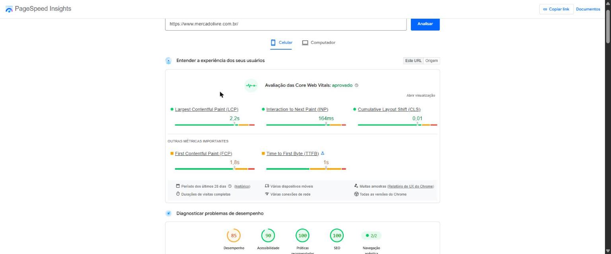

# Entrega Lab05 S01 + S02 — Desempenho e acessibilidade do site do Mercado Livre

**Sumário**

1. [Evidências dos 3 critérios](#evidências-dos-3-critérios)
2. [Pergunta de pesquisa](#pergunta-de-pesquisa)
3. [GQM (template de Basili)](#gqm-template-de-basili)
4. [Entidades, atributos e escalas](#entidades-atributos-e-escalas)
5. [Classificação nas 7 categorias de pesquisa (v1)](#classificação-nas-7-categorias-de-pesquisa-v1)
6. [Hipóteses](#hipóteses)
7. [Ética](#ética)
8. [Plano de coleta e análise e resultados do piloto](#plano-de-coleta-e-análise-e-resultados-do-piloto)
9. [Coleta completa e dados validados](#coleta-completa-e-dados-validados)
10. [Resultados](#resultados)
11. [Ameaças à validade (v1)](#ameaças-à-validade-v1)
12. [Checklist da entrega S01 + S02](#checklist-da-entrega-s01--s02)

As seções 1 a 7 vêm da proposta, escrita antes da coleta: [`evidencias.md`](evidencias.md), [`proposta.md`](proposta.md) (v1, de 17/11/2026, antes do início da coleta em 18/11/2026, 20h07 BRT) e [`etica.md`](etica.md). A seção 8 é o plano e o piloto. As seções 9 a 11 foram escritas em 26/11/2026, depois do fim da coleta (25/11/2026, 05h07 BRT) e da análise completa. Em caso de divergência, os documentos de origem valem.

## Evidências dos 3 critérios

Objeto de estudo: o site **https://www.mercadolivre.com.br/** (Mercado Livre Brasil, operado pela MercadoLibre, Inc., Nasdaq: MELI). Nenhum número foi estimado: cada valor foi copiado da fonte indicada, na data de acesso indicada. Valores em dólares americanos (US$), como publicados pela empresa; "mi" = milhões e "bi" = bilhões. Detalhes em [`evidencias.md`](evidencias.md).

| Critério | Evidência | Número | Fonte (link) | Data de acesso |
|---|---|---|---|---|
| Real | Site oficial do Mercado Livre no Brasil, público e acessível sem login | — (site no ar; a captura do PSI abaixo confirma que a URL responde e é analisada) | https://www.mercadolivre.com.br/ | 17/11/2026 |
| Real | Portal oficial de documentação para desenvolvedores (APIs por unidade de negócio, gestão de aplicações, segurança), com rodapé "Copyright © 2026 Mercado Livre Brasil Ltda." | — | https://developers.mercadolivre.com.br/pt_br/api-docs-pt-br | 18/11/2026 |
| Real | Empresa de capital aberto com página de Relações com Investidores ("The Leading Commerce and Fintech Ecosystem in Latin America") | Listada na Nasdaq como MELI | https://investor.mercadolibre.com/ | 18/11/2026 |
| Em operação | Relatório trimestral mais recente (release de resultados do 3º tri. de 2026, trimestre encerrado em 30/09/2026, divulgado em 04/11/2026, Form 8-K, anexo 99.1) | Receita líquida e receita financeira: US$ 10.750 mi no 3T26 (+45% a/a), total da região | https://www.sec.gov/Archives/edgar/data/0001099590/000109959026000027/meli-20260930xex991.htm | 18/11/2026 |
| Em operação | Comunicado recente da empresa (sala de imprensa oficial), de 04/11/2026: "Mercado Libre Revenue Reaches $10.75 billion in Q3 2026, up 45% year over year" | US$ 10,75 bi de receita no 3T26 | https://news.mercadolibre.com/en/financial-results-3erd-quarter-2026 | 18/11/2026 |
| Em operação | App oficial atualizado recentemente na Google Play (indício de manutenção ativa) | "Atualizado em 18 de nov. de 2026" | https://play.google.com/store/apps/details?id=com.mercadolibre&hl=pt_BR&gl=BR | 18/11/2026 |
| Em operação (CrUX) | Há dados de usuários reais do Chrome (CrUX) para a URL, no PSI web (pagespeed.web.dev, sem chave), aba **Celular**, recorte **Este URL**: "Período dos últimos 28 dias", "Muitas amostras (Relatório de UX do Chrome)". Captura: `docs/img/crux-2026-11-17.png` | Avaliação das Core Web Vitals: **aprovado**. p75: LCP 2,2 s; INP 164 ms; CLS 0,01; FCP 1,8 s; TTFB 1 s | https://pagespeed.web.dev/ (análise de https://www.mercadolivre.com.br/) | 17/11/2026 |
| Alto impacto | GMV (volume bruto de mercadorias) do 3T26, **total da região** | US$ 22.818 mi (≈ US$ 23 bi), +38% a/a em US$ e +33% a/a em moeda constante | SEC 8-K 3T26 (link acima) e comunicado de 04/11/2026 (link acima) | 18/11/2026 |
| Alto impacto | GMV do 3T26 **recortado para o Brasil** | **Valor absoluto em US$: não encontrado** (o release e o comunicado não trazem GMV por país). Só o crescimento: +44% a/a em US$ e +36% a/a em moeda constante; itens vendidos no Brasil +45% a/a | SEC 8-K 3T26 (tabelas de crescimento a/a por país, colunas Q3'25…Q3'26) e comunicado de 04/11/2026 | 18/11/2026 |
| Alto impacto | Receita líquida e receita financeira do 3T26 **no Brasil** (tabela por segmento: Brazil, Mexico, Argentina, Other Countries, Total) — melhor recorte Brasil em valor absoluto que a fonte oferece | US$ 6.001 mi no Brasil, de US$ 10.750 mi no total (3T25: US$ 4.009 mi) | SEC 8-K 3T26 (link acima), tabela de segmentos | 18/11/2026 |
| Alto impacto | Compradores únicos ativos do comércio no 3T26, **total da região** | ≈ 94 mi (+22% a/a); itens vendidos: 867 mi | SEC 8-K 3T26 e comunicado de 04/11/2026 (links acima) | 18/11/2026 |
| Alto impacto | Compradores únicos **recortados para o Brasil** | **Não encontrado.** Procurado no release 3T26 (SEC 8-K), no comunicado de 04/11/2026 e em notícias da imprensa brasileira sobre os resultados de 2026; nenhuma fonte oficial traz a contagem só do Brasil | — | 18/11/2026 |
| Alto impacto | Audiência mensal do domínio mercadolivre.com.br (Similarweb, página pública, cabeçalho "October 2026"; estimativa de terceiro) | 283,8 mi de visitas nos últimos 3 meses (a página não traz o número de um único mês); rank global #92; rank no Brasil #8; #1 na categoria "Ecommerce & Shopping > Marketplace (In Brazil)" | https://www.similarweb.com/website/mercadolivre.com.br/ | 18/11/2026 |
| Alto impacto | Downloads do app oficial "Mercado Livre" (desenvolvedor: Mercado Libre) na Google Play — **total mundial**, a loja não recorta por país | "500 mi+ downloads"; 28,4 mi avaliações (nota 4,9); "#3 principais apps gratuitos compras" | https://play.google.com/store/apps/details?id=com.mercadolibre&hl=pt_BR&gl=BR | 18/11/2026 |

A captura mostra só a interface pública do PageSpeed Insights, sem login e sem dados pessoais.

**O que não se pode afirmar com estas evidências:**
- **Recorte Brasil incompleto.** O MercadoLibre não publica GMV nem compradores únicos por país em valor absoluto, só taxas de crescimento por país. O único valor absoluto do Brasil é a **receita** por segmento (US$ 6.001 mi no 3T26, cerca de 56% do total). Ele não deve ser convertido em "GMV do Brasil" nem em "compradores do Brasil".
- **Downloads.** O número da Google Play é mundial e não inclui a App Store (a página da App Store não pôde ser lida: HTTP 429). Downloads não equivalem a usuários ativos.
- **Audiência.** Os números do Similarweb são estimativas de um painel de terceiros. Outras ferramentas (por exemplo, Semrush) publicam valores bem diferentes, por isso só um ranking foi usado.
- **Datas de acesso.** A captura do CrUX é de 17/11/2026; as demais fontes, de 18/11/2026. Valores de páginas dinâmicas (Google Play, Similarweb) podem ter mudado depois.

## Pergunta de pesquisa

> O desempenho e a acessibilidade do site do Mercado Livre variam conforme o tipo de página, o perfil de dispositivo e o horário de acesso? E a medição sintética reflete a experiência dos usuários reais?

A pergunta tem duas partes:
- a primeira trata do efeito de três fatores controlados pelo grupo (tipo de página, perfil e horário), respondida por H1–H4;
- a segunda trata da validade da própria medição (sintética × campo), respondida por H5.

**Decisões fixadas antes da coleta** (não mudam depois de ver os dados):

1. **Métricas primárias:** LCP, TTFB e nº de auditorias de acessibilidade reprovadas. Todas as outras métricas são **descritivas** e não entram em teste de hipótese.
2. **Perfil de H2 e H4:** o teste primário usa o perfil **móvel** do Lighthouse. O desktop é relatado só como análise de sensibilidade.
3. **Testes bilaterais** em todas as hipóteses (H1–H5), inclusive em H1 e H3, cuja hipótese de pesquisa tem uma direção esperada.
4. **Correção de Holm** sobre os 5 testes primários, com α = 0,05. Os post-hoc também são corrigidos.
5. **Unidade de análise:** a URL em H2/H4 (n = 6 por tipo); a medição com efeitos aleatórios de URL e dia em H1/H3; o par por URL em H5.
6. **Janelas de horário:** pico = execuções das 20h07 e 22h07 BRT; madrugada = execuções das 03h07 e 05h07 BRT. A escolha se apoia no tráfego agregado do IX.br de 18/11/2026 (Max 46,20 Tbps no gráfico diário, com pico entre 20h e 22h e vale por volta das 04h); a justificativa completa está em [`proposta.md`, "Horário de pico"](proposta.md#horário-de-pico).

## GQM (template de Basili)

**Objetivo (Goal):**

| Elemento do template | Preenchimento |
|---|---|
| Analisar | o site do Mercado Livre (mercadolivre.com.br) |
| com o propósito de | caracterizar e comparar |
| com respeito a | desempenho de carregamento e acessibilidade |
| do ponto de vista | do usuário final |
| no contexto de | páginas públicas (categoria, busca, produto e home) medidas com perfis móvel e desktop em horários de pico e de baixa demanda (madrugada) |

**Perguntas (Questions) e métricas (Metrics):**

| Pergunta | Métricas | Papel |
|---|---|---|
| Q1. O perfil de dispositivo afeta o carregamento? | **LCP** (primária); FCP, Speed Index, TBT (descritivas) | H1 |
| Q2. O tipo de página afeta desempenho e peso? | **LCP** (primária); peso total (bytes) e nº de requisições (descritivas) | H2 (LCP). Bytes e requisições são só descritivas |
| Q3. O horário de pico piora a resposta do servidor? | **TTFB** (auditoria `server-response-time`, primária); LCP (descritiva nesta pergunta) | H3 |
| Q4. Quantas barreiras de acessibilidade existem e onde? | **Nº de auditorias de acessibilidade reprovadas** (primária), também detalhado por tipo de auditoria (contraste, rótulos, `alt` etc.); nota de acessibilidade (descritiva) | H4 |
| Q5. A medição sintética reflete a experiência dos usuários reais? | LCP sintético (mediana por URL, perfil móvel) × p75 de LCP do CrUX; categoria CrUX (FAST/AVERAGE/SLOW). O INP do CrUX é só descritivo, porque o Lighthouse não mede INP (o TBT é apenas um proxy) | H5 |

As métricas primárias foram fixadas antes da coleta. As notas de 0 a 100 do Lighthouse não são primárias, de propósito, por causa da Lei de Goodhart ([`proposta.md`, "Armadilhas de medição"](proposta.md#armadilhas-de-medição)).

## Entidades, atributos e escalas

| Métrica | Entidade | Atributo | Direta / derivada | Escala | Estatísticas permitidas |
|---|---|---|---|---|---|
| TTFB | Recurso (infraestrutura do ML) | Externo: tempo de resposta do servidor | Direta (observada no carregamento) | Razão | Todas (média geométrica, razões, testes paramétricos ou não paramétricos) |
| LCP, FCP, Speed Index, TBT | Produto (página web) | Externo: tempo percebido | **Derivada**: o PSI simula o throttling (Lantern) a partir de um carregamento | Razão | Todas, analisadas em escala log |
| Peso total, nº de requisições | Produto (página web) | Interno: tamanho | Direta | Razão | Todas |
| Nº de auditorias de acessibilidade reprovadas | Produto (página web) | Externo: acessibilidade (barreiras detectáveis automaticamente) | Direta (contagem) | Razão (discreta) | Mediana, contagens, testes não paramétricos |
| Nota de desempenho e de acessibilidade (0–100) | Produto | Externo, agregado | **Derivada**: soma ponderada de curvas log-normais | Tratada como **ordinal** | Mediana, percentis, testes de postos. **Não usar médias** |
| Categoria CrUX (FAST/AVERAGE/SLOW) | Produto em uso | Externo: experiência do usuário | Derivada (p75 de campo) | Ordinal | Moda, proporções, kappa |
| p75 de LCP do CrUX | Produto em uso | Externo | Derivada (agregação de 28 dias) | Razão | Comparação pareada |

Consequências da escala para a análise:
- os tempos (razão) são analisados em log e os efeitos são relatados como **razões** (ex.: "1,15× mais lento");
- a contagem de auditorias reprovadas é discreta e quase constante entre repetições, por isso usa testes de postos sobre o valor agregado por URL;
- as notas e a categoria CrUX são ordinais e só aceitam mediana, percentis, proporções e testes de postos ou de concordância.

### Mapeamento na ISO/IEC 25010

**Versão usada: ISO/IEC 25010:2023** (2ª edição, que substitui a de 2011). Fonte: página oficial da norma na ISO, <https://www.iso.org/standard/78176.html>, e prévia oficial do prefácio em <https://webstore.ansi.org/preview-pages/ISO/preview_ISO+IEC+25010-2023.pdf> (acesso em 17/11/2026).

| Característica (2023) | Subcaracterística | Métricas do estudo |
|---|---|---|
| Eficiência de desempenho (*performance efficiency*) | Comportamento temporal (*time behaviour*) | TTFB, LCP, FCP, Speed Index, TBT |
| Eficiência de desempenho | Utilização de recursos (*resource utilization*) | Peso total (bytes), nº de requisições |
| Capacidade de interação (*interaction capability*, que substitui "usabilidade" da versão 2011) | Inclusividade (*inclusivity*) e assistência ao usuário (*user assistance*) | Nº de auditorias de acessibilidade reprovadas, por tipo; nota de acessibilidade |

Na versão 2011, a acessibilidade era subcaracterística de *usabilidade*. A versão 2023 a divide em *inclusividade* e *assistência ao usuário*, dentro de *capacidade de interação*.

### SLI/SLO de referência

- **SLO:** LCP ≤ 2,5 s no p75, que é o limiar "bom" dos Core Web Vitals. Fonte: web.dev, "Largest Contentful Paint (LCP)", <https://web.dev/articles/lcp> (acesso em 17/11/2026).
- **SLI:** a fração das medições de cada combinação tipo × perfil × horário que cumpre LCP ≤ 2,5 s.
- O uso é **descritivo** e não entra em teste de hipótese. Ele adapta ao site do ML a ideia de medir a operação (Lab03), já que não há acesso aos deploys para calcular métricas DORA.

## Classificação nas 7 categorias de pesquisa (v1)

| Categoria | Classificação | Justificativa |
|---|---|---|
| Natureza | Aplicada | Gera conhecimento sobre um software em produção, com impacto direto para os usuários e para a empresa. Não busca teoria geral |
| Objetivos | Descritiva e explicativa | Descritiva porque caracteriza desempenho e acessibilidade (Q1–Q4). Explicativa porque testa se tipo de página, perfil e horário explicam a variação (H1–H4) |
| Abordagem | Quantitativa | Todas as métricas são numéricas e a análise usa estatística descritiva e testes de hipótese |
| Procedimentos | Quase-experimento de campo, com análise de dados de operação (CrUX) | Os fatores e níveis são escolhidos pelo grupo, mas os objetos (URLs) são escolhidos por critério, sem randomização, e o sistema não é controlado. O CrUX traz dados de operação de usuários reais |
| Tempo | Longitudinal curto | Medidas repetidas 4 vezes por dia durante 7 dias (18/11 a 25/11/2026) |
| Controle | Parcial | O grupo controla as URLs, os horários, o perfil e a ordem das chamadas (sorteada). Não controla o ML (deploys, promoções) nem a infraestrutura do PSI |
| Nível de evidência | Moderado | Ganha força com o desenho fatorial, as repetições e a triangulação com o CrUX. Perde com a falta de randomização, o período atípico (semana anterior à Black Friday) e a medição sintética |

**Pendência (integrante A):** conferir esta tabela com o material da **Aula 8**. Ela foi montada a partir do §5.5 do [design](superpowers/specs/2026-11-16-mercadolivre-desempenho-acessibilidade-design.md), sem acesso ao material da aula. A versão revisada das 7 categorias é entrega da S03.

## Hipóteses

Todas as hipóteses foram **fixadas antes da coleta**. Todos os testes são **bilaterais** e passam pela **correção de Holm** sobre os 5 testes primários (α = 0,05).

| | Hipótese de pesquisa (H1) | H0 | Métrica (primária) | Unidade de análise | Perfil usado | Teste (a priori) |
|---|---|---|---|---|---|---|
| H1 | O LCP no perfil móvel do Lighthouse é diferente do LCP no perfil desktop (direção esperada: maior no móvel) | Não há diferença de LCP entre os perfis | LCP | Medição, com efeitos aleatórios de URL e dia | Móvel × desktop (é o próprio fator) | Modelo linear misto em log, efeito como razão com IC 95% |
| H2 | O LCP difere entre categoria, busca e produto | Não há diferença de LCP entre os tipos | LCP | **URL** (mediana por URL, n = 6 por tipo) | **Móvel** (desktop como sensibilidade) | Kruskal-Wallis, ε², post-hoc de Dunn |
| H3 | O TTFB no pico é diferente do TTFB na madrugada (direção esperada: maior no pico) | Não há diferença de TTFB entre pico e madrugada | TTFB | Medição, com efeitos aleatórios de URL e dia | Ambos (o perfil entra como fator no modelo) | Modelo linear misto em log, efeito como razão com IC 95% |
| H4 | O nº de auditorias de acessibilidade reprovadas difere entre os tipos | Não há diferença no nº de reprovadas entre os tipos | Nº de auditorias reprovadas | **URL** (valor modal por URL, n = 6 por tipo) | **Móvel** (desktop como sensibilidade) | Kruskal-Wallis, ε², post-hoc de Dunn |
| H5 | O LCP sintético difere do p75 de LCP do CrUX (análise de concordância) | Não há diferença sistemática entre o LCP sintético e o p75 do CrUX | LCP | Par por URL (só as URLs com dados no CrUX) | Móvel | Wilcoxon pareado, Spearman, Bland-Altman e kappa de Cohen nas categorias |

Notas:
- **Bilateralidade:** H1 e H3 têm uma direção esperada, mas o teste é bilateral para não descartar um resultado no sentido oposto (ex.: madrugada mais lenta por janelas de manutenção).
- **H1 é parcialmente verdadeira por construção**, porque o perfil móvel aplica throttling. O interesse está no **tamanho** da diferença e na interação com tipo e horário, não só no p-valor. Isso é tratado como ameaça de construto.
- **H2 e H4 usam a URL como unidade** porque as repetições da mesma URL não são amostras independentes (a acessibilidade quase não muda entre repetições). Usar as 84 medições como amostras seria pseudorreplicação.
- **H5:** as URLs sem dados no CrUX são listadas, e o valor da origem é usado só como referência.
- A home fica fora de todos os testes e entra só na descritiva.

## Ética

Versão resumida. O documento completo, com os `robots.txt` lidos, a conferência URL a URL e os termos de uso, está em [`etica.md`](etica.md) (registro de 18/11/2026).

| Pergunta | Resposta |
|---|---|
| Alguma URL de `config/urls.csv` é proibida pelo `robots.txt` (`User-agent: *`)? | **Não.** As 6 categorias, as 6 buscas e a home são permitidas. |
| As 12 URLs de produto (`url` e `url_reserva`) são permitidas? | **Sim**, as 12, incluindo a reserva `/up/MLBU3319410517` de `pro-6`. |
| Há regra que nomeia o PageSpeed Insights / Lighthouse? | **Não.** Vale o grupo `User-agent: *`. |
| Achados que pedem decisão do coordenador | (1) Os 3 hosts bloqueiam `ClaudeBot` e `Claude-User` em `/`, e a seleção da #5 foi feita com um agente Claude no navegador. (2) O caminho `/mais-vendidos/MLB`, usado para escolher os produtos, é proibido para `*`. (3) O texto atual dos Termos e Condições do ML não foi lido no site oficial. |

**Quem acessa as páginas na coleta.** O nosso código (GitHub Actions) não baixa páginas do ML: ele chama a API do PageSpeed Insights, e é a infraestrutura do Google que carrega cada URL, 1 carregamento por chamada, sem seguir links. Mesmo assim, o grupo trata o PSI como se fosse um robô seu e só pede URLs permitidas pelo grupo `User-agent: *` dos 3 hosts (`www.`, `lista.` e `produto.mercadolivre.com.br`).

**Regras do estudo** (obrigatórias para o coletor e para os integrantes):

1. **No máximo 1 requisição por segundo** a qualquer host. Chamadas em sequência, com ≥ 2 s entre o fim de uma e o início da próxima, sem paralelismo. Cada URL é carregada 2 vezes por execução (móvel e desktop), em 4 execuções por dia (20h07, 22h07, 03h07 e 05h07 BRT), o que dá cerca de 0,0018 req/s de média por site.
2. **Sem teste de carga ou estresse** em sistemas do ML ou do Google. O volume é fixo: 38 chamadas por execução, mais no máximo 2 novas tentativas por chamada com erro (teto de 114).
3. **Sem login.** Nenhuma URL exige conta, e nenhuma credencial do ML é usada.
4. **Sem dados pessoais.** Só páginas públicas de catálogo. Não se guardam nomes, avaliações, perguntas de usuários, dados de vendedores pessoa física nem a localização de entrega.
5. **Capturas de tela removidas antes de publicar.** O coletor apaga do JSON do Lighthouse as auditorias `final-screenshot`, `screenshot-thumbnails` e `full-page-screenshot`. O JSON nunca entra no git.
6. **Chave só no secret `PSI_API_KEY`.** Nunca em código, configuração versionada ou logs (Google APIs ToS §4(b)).
7. **Detecção de bloqueio e descarte.** Se o `finalUrl` contiver `/captcha/` ou `/gz/account-verification`, se o título for "Segurança — Mercado Livre", se o `finalUrl` for de login, se o status HTTP for ≠ 200 ou se a página for de erro, a medição é marcada como `bloqueada` e excluída da análise. O CAPTCHA nunca é resolvido nem contornado, e não se trocam User-Agent, IP ou chave.
8. **Respeito ao `robots.txt`.** Toda URL nova ou trocada passa pela checagem de [`etica.md`, seção 3](etica.md#3-urls-de-produto-conferência-e-regra-de-checagem) antes do commit.
9. **Páginas proibidas só à mão.** `/mais-vendidos/MLB…` e outros caminhos proibidos só podem ser abertos por um integrante, num navegador comum, para selecionar URLs. Nunca por script, agente ou PSI.
10. **Agentes de IA:** recomendação de [`etica.md`, seção 5](etica.md#5-achado-bloqueio-a-claudebot-e-claude-user): nenhum agente de IA abre páginas do ML; o que for preciso ver no site é feito por um integrante, à mão. A decisão é do coordenador.

**Pontos de atenção registrados em `etica.md`:**
- **Uso de agente de IA.** Um agente Claude abriu páginas do ML pelo Chrome do integrante em 17 e 18/11/2026 (seleção da #5 e leitura dos `robots.txt`), e em 18/11/2026, 19h13 BRT, um agente fez 1 chamada à API do PSI para a home, autorizada pelo integrante B (issue #7). Esse uso entra nas limitações do documento final.
- **Termos do ML não lidos na fonte oficial.** Nenhuma cláusula é citada como confirmada. A avaliação provisória é que medir desempenho e acessibilidade por 1 carregamento do PSI, sem conta e sem guardar conteúdo, fica fora do alvo de uma cláusula contra robôs e scraping, mas isso é uma interpretação do grupo.
- **Google APIs ToS §5(e).** O JSON do Lighthouse (sem as capturas) é guardado como dado bruto de pesquisa; o grupo entende que métricas e auditorias são o propósito da API, e não conteúdo de terceiros. Isso é uma interpretação, registrada como limitação.

**Pendências** (de [`etica.md`, seção 8](etica.md#8-pendências)): ler os Termos e Condições Gerais do ML e registrar as cláusulas sobre robôs e automação (integrante A); ler a cota da PSI API no console do projeto (quem criou a chave); decidir a política sobre agentes de IA e declarar o uso já feito nas limitações (coordenador / grupo).

## Plano de coleta e análise e resultados do piloto

### Desenho fatorial

O estudo mede o site do Mercado Livre de fora, pela API do PageSpeed Insights (PSI), em execuções agendadas no GitHub Actions. O desenho é um **fatorial 3 × 2 × 2**, com a home como referência descritiva:

| Fator | Níveis | Unidade experimental |
|---|---|---|
| Tipo de página | categoria, busca, produto (6 URLs cada) | **URL** |
| Perfil de dispositivo | móvel × desktop (parâmetro `strategy` da PSI) | medição |
| Horário | pico (20h07 e 22h07 BRT) × madrugada (03h07 e 05h07 BRT) | medição |
| Home (referência) | `https://www.mercadolivre.com.br/`, fora dos testes | — |

- **Perfil móvel:** a limitação de rede e CPU é fixada pela PSI: 4G lento simulado (150 ms de RTT, 1.638,4 kb/s) e CPU 1,2×, segundo o relatório da PSI de 19/11/2026 ([`dados.md`](dados.md)). É um celular emulado num servidor da América do Norte, e não um usuário real no Brasil.
- **Janelas:** a execução entra na janela pelo horário real de início: pico de 18h a 23h59 e madrugada de 00h a 07h59 (BRT). Execuções fora dessas faixas são descartadas. A escolha do pico se apoia no tráfego agregado do IX.br ([`proposta.md`](proposta.md)).
- **Execução:** cada execução faz 19 URLs × 2 perfis = 38 chamadas sequenciais, em **ordem sorteada**, com pelo menos 2 s entre elas (limite ético de 1 requisição por segundo).
- **Volume previsto:** 4 execuções por dia durante 7 dias (18/11 20h07 → 25/11 05h07), ou seja, 28 execuções e **1.064 medições**. Cada combinação tipo × perfil × horário tem 84 medições, mas só **6 unidades independentes** (as URLs) para o fator tipo.
- **Perdas nas duas primeiras noites:** na noite de 18→19/11, o `schedule` do GitHub atrasou as duas execuções de pico, que caíram na madrugada, e não disparou as duas de madrugada (anomalia 1, [`anomalias.md`](anomalias.md)). Desde 19/11, cada horário tem várias tentativas, e um porteiro deixa medir só a primeira dentro de 60 min do horário nominal ([`agendador.md`](agendador.md)). Mesmo assim, na noite de 19→20/11 o `schedule` disparou só duas vezes, e só a execução das 05h07 foi medida (anomalia 2). A partir de 20/11, os disparos vêm do agendador externo, e a coleta ficou completa.
- **Volume possível:** com as duas perdas, a coleta principal tem no máximo **23 execuções** (10 de pico e 13 de madrugada), ou 874 medições, e as noites de 18/11 e 19/11 ficam sem pico. Até a manhã de 23/11, foram 15 execuções, todas com 38 linhas.

### Plano de análise

As escolhas foram fixadas antes da coleta (design §5.8). Antes de qualquer teste, o filtro mínimo (`analysis/stats.py`, `filtro_minimo`) mantém só as linhas de disparos agendados, sem bloqueio, sem erro e dentro de uma das duas janelas.

| Hipótese | Métrica | Unidade de análise | Perfil | Teste | Tamanho de efeito |
|---|---|---|---|---|---|
| H1: o LCP difere entre os perfis | LCP | medição, com efeitos aleatórios de URL e de dia | os dois | modelo linear misto em log | razão móvel/desktop com IC 95% |
| H2: o LCP difere entre os tipos | LCP | URL (mediana) | móvel; desktop como sensibilidade | Kruskal-Wallis + Dunn | ε² |
| H3: o TTFB difere entre pico e madrugada | TTFB observado | medição, com efeitos aleatórios de URL e de dia | os dois | modelo linear misto em log | razão pico/madrugada com IC 95% |
| H4: o nº de auditorias reprovadas difere entre os tipos | nº de reprovadas | URL (moda) | móvel; desktop como sensibilidade | Kruskal-Wallis + Dunn | ε² |
| H5: o LCP sintético concorda com o p75 do CrUX | LCP | par por URL | móvel | Wilcoxon pareado, Spearman, Bland-Altman | kappa nas categorias do CrUX |

- O modelo misto é `log(métrica) ~ perfil * horário * tipo`, com codificação de soma, de modo que o efeito de cada fator é estimado na média dos outros.
- Todos os testes são bilaterais, com **correção de Holm** sobre os 5 testes primários (α = 0,05).
- **Alternativa robusta:** se mais de 5% dos resíduos padronizados do modelo misto passarem de ±3, o modelo é ajustado de novo sobre postos alinhados (ART). Esse critério foi fixado antes de olhar os p-valores.
- **Descritiva:** mediana, IQR, p75 e p90 por combinação, por URL e no agregado, com a fração de medições que cumpre o SLO de LCP ≤ 2,5 s.
- **Scripts:** `analysis/stats.py` (funções estatísticas, com testes em `tests/test_stats.py`) e `analysis/analise.py`, que roda tudo com `python analysis/analise.py --input data/raw`.

### Piloto incorporado

As primeiras execuções da coleta servem de piloto. Elas validam a coleta e dão a variância usada na simulação de poder. O piloto previsto eram as 4 execuções da noite de 18→19/11 (detalhes em `analysis/out/piloto/relatorio.md`, gerado por `analysis/piloto.py`).

**Cobertura: 76/152 linhas (2 de 4 execuções).**

| Horário nominal (BRT) | Execução | Início real (BRT) | Janela gravada | Linhas |
|---|---|---|---|---|
| 18/11 20h07 | `20261119T040444Z` | 19/11 01h04 | madrugada | 38/38 |
| 18/11 22h07 | `20261119T083531Z` | 19/11 05h35 | madrugada | 38/38 |
| 19/11 03h07 | não executou | — | — | 0/38 |
| 19/11 05h07 | não executou | — | — | 0/38 |
| **Total** | | | | **76/152** |

- **Bloqueios, erros e reservas:** nenhuma linha bloqueada, com erro ou com URL reserva. 2 linhas (2,6%) precisaram de uma segunda tentativa. Todo o TTFB veio da fonte observada (`server-response-time`). Nenhuma linha precisou ser descartada.
- **Medianas do piloto** (madrugada):

  | Tipo | LCP desktop | LCP móvel | TTFB móvel | Reprovadas (móvel) |
  |---|---|---|---|---|
  | Categoria | 926 ms | 6.679 ms | 12 ms | 2 |
  | Busca | 1.220 ms | 4.399 ms | 25,5 ms | 4 |
  | Produto | 1.140 ms | 4.598 ms | 27 ms | 4 |
  | Home | 1.152 ms | 6.604 ms | 25 ms | 3 |

- **Variância entre execuções da mesma URL:** o coeficiente de variação mediano do LCP foi de 9% no móvel e de 8,5% no desktop. O do TTFB foi de 40% e 31%, porque são valores pequenos (dezenas de ms). As auditorias reprovadas quase não mudam: só 3 das 38 combinações URL × perfil mudaram de uma execução para a outra.
- **LCP em dois níveis nas categorias (móvel):** o LCP das páginas de categoria no celular cai em dois níveis, perto de 3 s ou perto de 10 s, com o FCP acompanhando o salto e sem mudança no peso da página. Duas URLs trocaram de nível entre as duas execuções. As linhas são válidas e foram mantidas. Como a distribuição não é log-normal nesse grupo, isso reforça o uso da mediana por URL e de testes não paramétricos em H2.
- **O que mudou por causa do piloto:** a falha do `schedule` levou ao esquema de tentativas e porteiro descrito acima. O desenho, as métricas e os testes não mudaram.

### Efeito mínimo detectável

A duração da coleta é fixa, então a simulação de poder (reaproveitando o Lab04) não define o número de dias: ela estima o **menor efeito que o desenho detecta com poder ≥ 0,8**. Desenho simulado: 6 URLs por tipo, 7 dias, 2 execuções por janela, com a variância do piloto. Detalhes em `analysis/out/poder/relatorio.md`, gerado por `analysis/poder.py`.

O efeito é uma razão r: em H2 e H4, o tipo mais alto é r× o mais baixo; em H3, o TTFB do pico é r× o da madrugada.

| Hipótese | Datasets por nível | Menor r com poder ≥ 0,8 | Erro tipo I (r = 1,00) |
|---|---|---|---|
| H2: LCP entre os tipos (móvel) | 1.000 | **1,75** (> 1,30 na grade do plano) | 0,039 |
| H3: TTFB pico × madrugada | 200 | **1,12** | 0,060 |
| H4: reprovadas entre os tipos | 1.000 | **1,50** (> 1,30 na grade do plano) | 0,040 |

- O erro tipo I observado fica entre 0,03 e 0,07 nas três hipóteses, como esperado para α = 0,05.
- **H3 é sensível:** detecta um pico 12% mais lento, porque usa todas as medições no modelo misto.
- **A simulação supôs 7 dias com 2 execuções por janela.** Com as perdas das duas primeiras noites (no máximo 10 execuções de pico e 13 de madrugada), o poder real de H3 tende a ser um pouco menor. Em H2 e H4 o efeito é pequeno, porque cada URL continua com mais de 20 execuções.
- **H2 e H4 só detectam diferenças grandes entre os tipos:** 75% no LCP e 50% nas reprovadas. Com 6 URLs por tipo, a variação de uma URL para outra domina. Um resultado não significativo em H2 ou H4 **não** mostra que os tipos são iguais, só que a diferença, se existe, é menor do que o desenho consegue ver. Isso entra na ameaça à validade de conclusão.

### Limitações do piloto

- Só 2 execuções por URL: as variâncias são uma ordem de grandeza, não um valor preciso.
- Não há execução de pico nem variação entre dias no piloto. Na simulação, a variação entre dias veio dos dias coletados até 23/11.
- A simulação supõe um LCP log-normal e não reproduz os dois níveis do LCP das categorias. O poder real de H2 tende a ser menor que o simulado.

## Coleta completa e dados validados

A coleta principal foi de **18/11/2026, 20h07, a 25/11/2026, 05h07 BRT**, e foi encerrada nessa data, sem extensão para a Black Friday ([`proposta.md`, "Extensão da coleta"](proposta.md#extensão-da-coleta)).

| Item | Valor | Fonte |
|---|---|---|
| Execuções previstas | 28 (4 por dia × 7 dias), 1.064 linhas | design §5.6 |
| Execuções no dataset | **23** (10 de pico e 13 de madrugada), **873 linhas** | [`data/processed/dataset.csv`](../data/processed/dataset.csv) |
| Reconciliação | 873 no dataset + 1 excluída + 38 × 5 execuções ausentes = 1.064 (fecha) | [`anomalias.md`, "Validação da coleta principal"](anomalias.md#validação-da-coleta-principal-scriptsvalidatepy-b-7) |
| Linhas excluídas | 1 (0,1%): `cat-3`, móvel, pico de 20/11, erro 400 da PSI depois de 3 tentativas (regra D2) | idem |
| Bloqueios e URLs reserva | nenhum | idem |
| Versão do Lighthouse | 13.6.0 em todas as linhas (nenhuma mudança de versão, regra S1) | idem |
| JSONs brutos da PSI | release `coleta-principal` do repositório (fora do git, por ética) | [`anomalias.md`](anomalias.md), #B-8 |

- **Dados versionados:** os CSVs brutos de cada dia estão em `data/raw/` e o dataset validado em `data/processed/dataset.csv`, gerado por `python scripts/validate.py` com as regras de descarte (D1–D4) e de sinalização (S1–S2) da [`proposta.md`](proposta.md#regras-de-validação). A análise lê só o dataset validado.
- **Anomalias da coleta** ([`anomalias.md`](anomalias.md)):
  1. **Noite de 18→19/11:** o `schedule` do GitHub atrasou as duas execuções de pico, que caíram na madrugada e contam como as madrugadas de 19/11, e não disparou as duas de madrugada.
  2. **Noite de 19→20/11:** o `schedule` disparou só duas vezes; o porteiro recusou um disparo fora da tolerância, e só a execução das 05h07 foi medida. Desde 20/11, os disparos vêm do agendador externo, e a coleta ficou completa.
  3. **25/11, 20h07:** uma execução depois do fim da coleta gravou 38 linhas no CSV bruto, que ficaram fora do dataset. O workflow foi desligado em 26/11.
- **Efeito no desenho:** as noites de 18/11 e 19/11 ficaram sem pico, e a madrugada tem 3 execuções a mais que o pico (13 × 10).

## Resultados

Todos os números desta seção vêm de `python analysis/analise.py --input data/processed/dataset.csv` (873 linhas, 23 execuções). O relatório completo está em [`analysis/out/relatorio.md`](../analysis/out/relatorio.md), e as tabelas em `analysis/out/*.csv`.

### Descritiva

Medianas por tipo, perfil e janela ([`descritiva_agregado.csv`](../analysis/out/descritiva_agregado.csv), [`sli_lcp.csv`](../analysis/out/sli_lcp.csv)). SLI = fração das medições com LCP ≤ 2,5 s, o limiar "bom" dos Core Web Vitals.

| Tipo | Perfil | LCP madrugada (ms) | LCP pico (ms) | TTFB madrugada / pico (ms) | Reprovadas | SLI madrugada / pico |
|---|---|---|---|---|---|---|
| Categoria | desktop | 995 | 1.070 | 9 / 9 | 2 | 100% / 100% |
| Categoria | móvel | 3.217 | 3.550 | 12,5 / 11 | 2 | 0% / 0% |
| Busca | desktop | 1.476 | 1.373 | 28 / 28 | 4 | 96% / 97% |
| Busca | móvel | 4.092 | 4.394 | 25,5 / 28 | 4 | 0% / 0% |
| Produto | desktop | 1.466 | 1.402 | 27 / 27 | 5 | 100% / 100% |
| Produto | móvel | 4.745 | 4.645 | 25 / 25 | 4 | 0% / 0% |
| Home (referência) | desktop | 1.263 | 1.219 | 22 / 19,5 | 4 | 100% / 100% |
| Home (referência) | móvel | 5.885 | 3.998 | 19 / 40 | 3 | 0% / 0% |

- **No desktop**, praticamente todas as medições cumprem o limiar de 2,5 s; **no perfil móvel, nenhuma** cumpre, em nenhum tipo de página nem horário.
- O TTFB fica na casa das dezenas de ms nos dois perfis e nas duas janelas.
- As categorias têm o menor número de auditorias de acessibilidade reprovadas (2), contra 4 a 5 na busca e no produto.
- Boxplots: [`boxplot_lcp_ms.png`](../analysis/out/boxplot_lcp_ms.png), [`boxplot_ttfb_ms.png`](../analysis/out/boxplot_ttfb_ms.png) e [`boxplot_a11y_reprovadas.png`](../analysis/out/boxplot_a11y_reprovadas.png).

### Testes de hipótese

Testes bilaterais, com correção de Holm sobre os 5 testes primários ([`tabela_hipoteses.csv`](../analysis/out/tabela_hipoteses.csv)). As razões têm IC de Wald do modelo misto em log; o ε² tem IC percentil por bootstrap (2.000 reamostragens).

| Hipótese | Teste | n | Efeito (IC 95%) | p | p de Holm | Decisão (α = 0,05) |
|---|---|---|---|---|---|---|
| H1: o LCP difere entre os perfis | modelo misto, log(LCP) | 827 medições | razão móvel/desktop = **3,58** (3,44–3,72) | < 0,001 | < 0,001 | rejeita H0 |
| H2: o LCP difere entre os tipos (móvel) | Kruskal-Wallis, mediana por URL | 18 URLs | ε² = 0,08 (0,01–0,65); H = 1,28 | 0,529 | 0,529 | não rejeita H0 |
| H3: o TTFB difere entre pico e madrugada | modelo misto, log(TTFB) | 827 medições | razão pico/madrugada = **1,05** (0,97–1,13) | 0,233 | 0,466 | não rejeita H0 |
| H4: as reprovadas diferem entre os tipos (móvel) | Kruskal-Wallis, moda por URL | 18 URLs | ε² = **0,75** (0,73–0,91); H = 12,79 | 0,002 | 0,005 | rejeita H0 |
| H5: o LCP sintético concorda com o CrUX (móvel) | Wilcoxon pareado | 18 pares | kappa = −0,10; diferença média de **1.964 ms** | < 0,001 | < 0,001 | rejeita H0 (não há concordância) |

- **H1:** o LCP no perfil móvel é 3,6 vezes o do desktop, na média dos tipos e horários. O Cliff's delta sobre as medianas por URL é 1,00 (IC 1,00–1,00): todas as 18 URLs são mais lentas no móvel ([`cliffs_delta.csv`](../analysis/out/cliffs_delta.csv)). O resultado é esperado por construção, porque o perfil móvel aplica limitação de rede e CPU; o que interessa é o tamanho da diferença.
- **H2:** não houve diferença detectável de LCP entre os tipos no perfil móvel. Pela simulação de poder (seção 8), o desenho só detecta diferenças acima de ~75% entre o tipo mais lento e o mais rápido, então o resultado **não** mostra que os tipos são iguais. Na sensibilidade com o desktop, fora do Holm, a diferença aparece (H = 8,98, p = 0,011, ε² = 0,53; [`sensibilidade_desktop.csv`](../analysis/out/sensibilidade_desktop.csv)). No móvel, o LCP das categorias alterna entre ~3 s e ~10 s, o que espalha os valores.
- **H3:** o horário de pico não piorou o TTFB de forma detectável. O IC (0,97–1,13) exclui uma piora maior que 13%, e o desenho detectava um pico ~12% mais lento. O Cliff's delta de horário é 0,07 (IC −0,07 a 0,23).
- **H4:** o número de auditorias reprovadas difere entre os tipos, com efeito grande. No post-hoc de Dunn (p de Holm), as categorias têm menos reprovadas que a busca (p = 0,002) e que o produto (p = 0,014); busca e produto não diferem (p = 0,499). O desktop dá o mesmo resultado (p = 0,001).
- **H5:** o LCP sintético móvel fica, em média, 1.964 ms acima do p75 do CrUX (limites de concordância de −1.836 a 5.764 ms), sem correlação (Spearman ρ = 0,05) e sem concordância nas categorias FAST/AVERAGE/SLOW (kappa = −0,10). Todas as 18 URLs têm dado de campo da própria URL. Gráfico: [`bland_altman.png`](../analysis/out/bland_altman.png).

### Diagnóstico e decisões de análise

- **Alternativa robusta (ART):** o critério, fixado antes de olhar os p-valores, era reajustar com postos alinhados se mais de 5% dos resíduos padronizados passassem de ±3. Só 0,5% (H1) e 0,7% (H3) passaram, então valem os modelos em log ([`diagnostico_residuos.csv`](../analysis/out/diagnostico_residuos.csv)). O QQ-plot de H1 mostra uma cauda superior mais pesada, que vem do LCP em dois níveis das categorias ([`residuos_H1.png`](../analysis/out/residuos_H1.png), [`residuos_H3.png`](../analysis/out/residuos_H3.png)).
- **Mudança de versão do Lighthouse:** não houve, então a rodada sem os dias afetados não se aplica.
- **A home** entra só na descritiva, como referência.

## Ameaças à validade (v1)

A tabela completa, com as 19 ameaças, a mitigação de cada uma e a origem, está em [`ameacas.md`](ameacas.md) (v1, escrita em 25/11/2026). O resumo abaixo acrescenta o que os resultados da seção 10 mostraram. A versão final sai na S03 (#26).

| Tipo | Principais ameaças | Mitigação | O que os resultados mostraram |
|---|---|---|---|
| **Conclusão** | Baixo poder em H2 e H4 (6 URLs por tipo); perda de 5 execuções e desbalanceamento (10 de pico × 13 de madrugada); LCP em dois níveis nas categorias; comparações múltiplas | Tamanho de efeito com IC; simulação do efeito mínimo detectável; Holm; agregação por URL; critério do ART fixado a priori | H2 não significativo deve ser lido à luz do poder; o critério do ART não foi acionado (0,5% e 0,7% de resíduos além de ±3) |
| **Interna** | Esquenta da Black Friday durante toda a coleta; pico e madrugada cobrem dias diferentes; mudanças no site; mudança de versão do Lighthouse; falhas do agendamento | Calendário promocional registrado; efeito aleatório de dia; ordem sorteada; janela pelo horário real; porteiro e agendador externo | Nenhuma mudança de versão; nenhuma URL reserva; 1 linha excluída em 874 |
| **Construto** | "Perfil móvel" é limitação simulada (4G lento e CPU 1,2×), não um celular real; TTFB pequeno, provavelmente de borda (CDN); LCP sintético × usuário real; nota de acessibilidade ≠ WCAG; Goodhart, Campbell e McNamara | Chamar o fator de *perfil*; métricas brutas como primárias; triangular com o CrUX (H5); analisar as auditorias por tipo | **H5 confirmou a ameaça:** o LCP sintético não representa o usuário real (diferença média de ~2 s, ρ = 0,05, kappa = −0,10). Os valores absolutos servem para comparar fatores, não para dizer o que o usuário vê |
| **Externa** | O teste da PSI roda na América do Norte; 19 URLs populares não representam o catálogo; uma semana atípica (antes da Black Friday) não representa o ano | Usar só diferenças relativas; CrUX como referência de campo; limitar as conclusões a páginas populares do ML na semana anterior à Black Friday de 2026 | Sem mudança |

## Checklist da entrega S01 + S02

Itens pedidos no enunciado (seção 7 do PDF), com onde cada um está.

**Lab05S01 — Proposta**

- [x] Software com evidências dos três critérios (real, em operação, alto impacto): seção 1 e [`evidencias.md`](evidencias.md)
- [x] Pergunta de pesquisa: seção 2
- [x] Caminho(s) escolhido(s): medir o serviço de fora (PSI) combinado com a avaliação da qualidade do produto pela ISO/IEC 25010 (desempenho e acessibilidade): seções 2, 4 e 8
- [x] Primeira versão das 7 categorias: seção 5
- [x] Plano de coleta e de análise: seções 6 e 8
- [x] Coleta piloto: seção 8 e [`analysis/out/piloto/relatorio.md`](../analysis/out/piloto/relatorio.md)

**Lab05S02 — Coleta, análise e ameaças**

- [x] Coleta completa: seção 9 (23 execuções, 873 linhas)
- [x] Dados validados e versionados: seção 9, [`data/processed/dataset.csv`](../data/processed/dataset.csv), `data/raw/` e [`anomalias.md`](anomalias.md)
- [x] Análise descritiva: seção 10 e [`analysis/out/`](../analysis/out/)
- [x] Testes de hipótese: seção 10 e [`tabela_hipoteses.csv`](../analysis/out/tabela_hipoteses.csv)
- [x] Tamanho do efeito: seção 10 (razões com IC, ε² e Cliff's delta com IC por bootstrap, kappa)
- [x] Ameaças à validade: seção 11 e [`ameacas.md`](ameacas.md)
