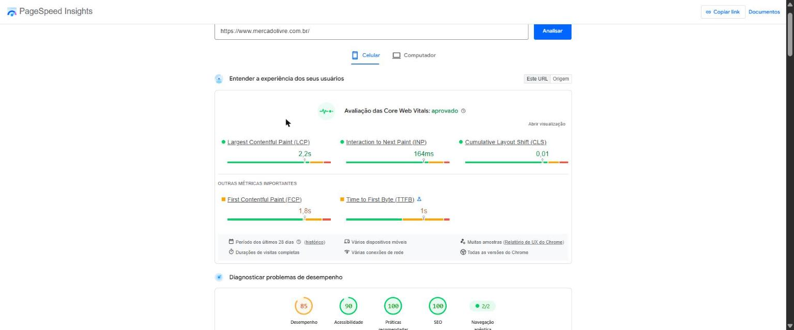

# Evidências dos 3 critérios (§2a do enunciado)

Issue #3 (`#A-2`). Formato da tabela conforme o §5.1 do design
(`docs/superpowers/specs/2026-11-16-mercadolivre-desempenho-acessibilidade-design.md`).

Objeto de estudo: o site **https://www.mercadolivre.com.br/** (Mercado Livre Brasil, operado pela
MercadoLibre, Inc., Nasdaq: MELI).

**Regras seguidas**
- Nenhum número foi estimado. Cada valor foi copiado da fonte indicada, na data de acesso indicada.
- Quando a fonte só traz o total da América Latina, a linha diz isso explicitamente ("total da região").
- Quando um dado não foi encontrado, a linha diz "não encontrado" e onde se procurou.
- Acesso aos sites do Mercado Livre: poucas páginas abertas manualmente, uma de cada vez (bem abaixo de 1 req/s), sem login e sem coleta de dados pessoais.
- Valores monetários em dólares americanos (US$), como publicados pela empresa. "mi" = milhões; "bi" = bilhões.

## Tabela de evidências

| Critério | Evidência | Número | Fonte (link) | Data de acesso |
|---|---|---|---|---|
| Real | Site oficial do Mercado Livre no Brasil, público e acessível sem login | — (site no ar; a captura do PSI abaixo confirma que a URL responde e é analisada) | https://www.mercadolivre.com.br/ | 17/11/2026 |
| Real | Portal oficial de documentação para desenvolvedores (APIs por unidade de negócio, gestão de aplicações, segurança), com rodapé "Copyright © 2026 Mercado Livre Brasil Ltda." | — | https://developers.mercadolivre.com.br/pt_br/api-docs-pt-br | 18/11/2026 |
| Real | Empresa de capital aberto com página de Relações com Investidores ("The Leading Commerce and Fintech Ecosystem in Latin America") | Listada na Nasdaq como MELI | https://investor.mercadolibre.com/ | 18/11/2026 |
| Em operação | Relatório trimestral mais recente (release de resultados do 3º tri. de 2026, trimestre encerrado em 30/09/2026, divulgado em 04/11/2026, Form 8-K, anexo 99.1) | Receita líquida e receita financeira: US$ 10.750 mi no 3T26 (+45% a/a), total da região | https://www.sec.gov/Archives/edgar/data/0001099590/000109959026000027/meli-20260930xex991.htm | 18/11/2026 |
| Em operação | Comunicado recente da empresa (sala de imprensa oficial), de 04/11/2026: "Mercado Libre Revenue Reaches $10.75 billion in Q3 2026, up 45% year over year" | US$ 10,75 bi de receita no 3T26 | https://news.mercadolibre.com/en/financial-results-3erd-quarter-2026 | 18/11/2026 |
| Em operação | App oficial atualizado recentemente na Google Play (indício de manutenção ativa) | "Atualizado em 18 de nov. de 2026" | https://play.google.com/store/apps/details?id=com.mercadolibre&hl=pt_BR&gl=BR | 18/11/2026 |
| Em operação (CrUX) | Há dados de usuários reais do Chrome (CrUX) para a URL, no PSI web (pagespeed.web.dev, sem chave), aba **Celular**, recorte **Este URL**: "Período dos últimos 28 dias", "Muitas amostras (Relatório de UX do Chrome)". Captura: `docs/img/crux-2026-11-17.png` | Avaliação das Core Web Vitals: **aprovado**. p75: LCP 2,2 s; INP 164 ms; CLS 0,01; FCP 1,8 s; TTFB 1 s | https://pagespeed.web.dev/ (análise de https://www.mercadolivre.com.br/) | 17/11/2026 |
| Alto impacto | GMV (volume bruto de mercadorias) do 3T26, **total da região** | US$ 22.818 mi (≈ US$ 23 bi), +38% a/a em US$ e +33% a/a em moeda constante | SEC 8-K 3T26 (link acima) e comunicado de 04/11/2026 (link acima) | 18/11/2026 |
| Alto impacto | GMV do 3T26 **recortado para o Brasil** | **Valor absoluto em US$: não encontrado** (o release e o comunicado não trazem GMV por país). Só o crescimento: +44% a/a em US$ e +36% a/a em moeda constante; itens vendidos no Brasil +45% a/a | SEC 8-K 3T26 (tabelas de crescimento a/a por país, colunas Q3'25…Q3'26) e comunicado de 04/11/2026 | 18/11/2026 |
| Alto impacto | Receita líquida e receita financeira do 3T26 **no Brasil** (tabela por segmento: Brazil, Mexico, Argentina, Other Countries, Total) — melhor recorte Brasil em valor absoluto que a fonte oferece | US$ 6.001 mi no Brasil, de US$ 10.750 mi no total (3T25: US$ 4.009 mi) | SEC 8-K 3T26 (link acima), tabela de segmentos | 18/11/2026 |
| Alto impacto | Compradores únicos ativos do comércio no 3T26, **total da região** | ≈ 94 mi (+22% a/a); itens vendidos: 867 mi | SEC 8-K 3T26 e comunicado de 04/11/2026 (links acima) | 18/11/2026 |
| Alto impacto | Compradores únicos **recortados para o Brasil** | **Não encontrado.** Procurado no release 3T26 (SEC 8-K), no comunicado de 04/11/2026 e em notícias da imprensa brasileira sobre os resultados de 2026; nenhuma fonte oficial traz a contagem só do Brasil | — | 18/11/2026 |
| Alto impacto | Audiência mensal do domínio mercadolivre.com.br (Similarweb, página pública, cabeçalho "October 2026"; estimativa de terceiro) | 283,8 mi de visitas nos últimos 3 meses (a página não traz o número de um único mês); rank global #92; rank no Brasil #8; #1 na categoria "Ecommerce & Shopping > Marketplace (In Brazil)" | https://www.similarweb.com/website/mercadolivre.com.br/ | 18/11/2026 |
| Alto impacto | Downloads do app oficial "Mercado Livre" (desenvolvedor: Mercado Libre) na Google Play — **total mundial**, a loja não recorta por país | "500 mi+ downloads"; 28,4 mi avaliações (nota 4,9); "#3 principais apps gratuitos compras" | https://play.google.com/store/apps/details?id=com.mercadolibre&hl=pt_BR&gl=BR | 18/11/2026 |

## Captura do CrUX

A captura mostra só a interface pública do PageSpeed Insights, sem login e sem dados pessoais.

## Limitações e o que não se pode afirmar

- **Recorte Brasil incompleto.** O MercadoLibre não publica GMV nem compradores únicos por país em valor absoluto; publica só taxas de crescimento por país. O único valor absoluto do Brasil encontrado é a **receita** por segmento (US$ 6.001 mi no 3T26, cerca de 56% do total). Não se deve converter isso em "GMV do Brasil" nem em "compradores do Brasil".
- **Downloads.** O número da Google Play é mundial, inclui todos os países em que o app existe e não inclui a App Store (a página da App Store não pôde ser lida: HTTP 429). Downloads não equivalem a usuários ativos.
- **Audiência.** Os números do Similarweb são estimativas de um painel de terceiros, não dados da empresa. Outras ferramentas (por exemplo, Semrush) publicam valores bem diferentes para o mesmo domínio, por isso só um ranking foi usado.
- **Datas de acesso.** A captura do CrUX é de 17/11/2026 (nome e data do arquivo). As demais fontes foram acessadas em 18/11/2026, no dia em que este documento foi montado; os valores de páginas dinâmicas (Google Play, Similarweb) podem mudar depois disso.
